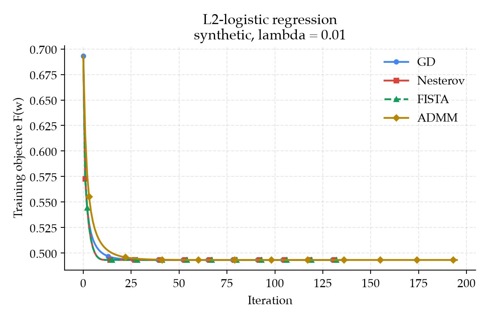
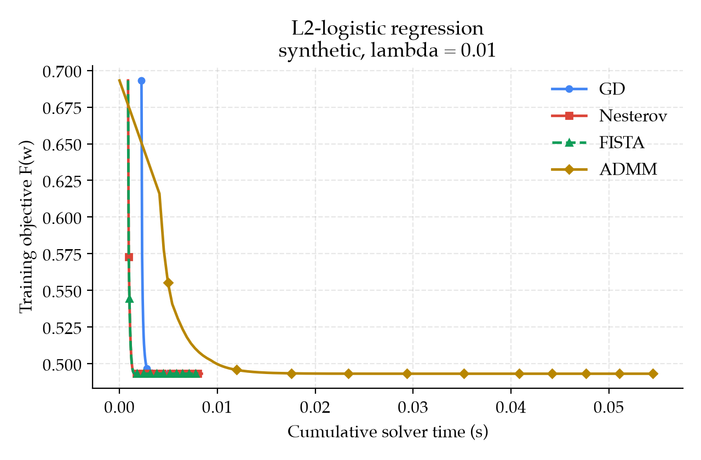

# Results (ZHAO Jixin)

Presenter: ZHAO Jixin, 26009105r. Duration: 8:00, covering 19:00 to 27:00
in the full talk on Tuesday, 3 November 2026.

Evidence: the 1 November 2026 19:34:56 local snapshot of
`results/summary.json`, identified by SHA-256 in report Section 4.1, and the
two linked objective figures. The ADMM penalty sweep is a separate standalone run.
Accuracy bars, logarithmic gap plots, and residual panels remain proposed
visuals. Source: `../report/sections/04_results.md`.

## R1. Experimental setup and coverage [1:00]

Visual: training/test split diagram plus a compact run-status table.

- Synthetic data: 1,500 train, 500 test, 51 parameters including bias.
- Same regularized objective, `lam=0.01`, zero start, 400 outer iterations.
- Scaling fits the training data. The bias receives the same L2 penalty.
- All four shared runs pass the `1e-6` gradient check. ADMM also passes its residual tests.

Speaker cue: identify the dataset and controls before discussing curves.
Data source: `data.py`, `problem.py`, and the runner's configuration.

## R2. Objective convergence [2:00]

- GD: 136 updates. Nesterov and FISTA: 138. ADMM: 195.
- All four reach objective approximately `0.49321404049`.
- Nesterov and default FISTA follow equivalent updates here.
- ADMM differs from the BFGS reference by approximately `8.3e-12`.

Speaker cue: trace the early decrease and the endpoints. The current figure
has a linear objective axis, which hides small terminal differences.
A semilog gap refinement should use reference `0.493214040484765` and a
display floor of `1e-14`. A fitted curve does not prove a rate theorem.

## R3. Wall-clock cost [1:30]

- Shared single-call times: GD 7.08 ms, Nesterov 8.52 ms, FISTA 8.11 ms, ADMM 54.90 ms.
- Default ADMM performs 322 Newton updates across 195 outer iterations.
- Each inner solve forms a dense Hessian and solves a linear system.
- This run favors GD. Repeated median timings remain pending.

Speaker cue: distinguish an outer ADMM iteration from a gradient step.
Point to time-to-gap thresholds once the full comparison is available.
Do not present these single-call times as a portable speed ranking.

## R4. Training and test accuracy [1:30]

Proposed visual: paired training/test bars for each algorithm, annotated with
convergence status. The table below provides the measured values until rendered.

| Method | Train | Test |
| --- | ---: | ---: |
| GD | 76.67% | 73.80% |
| Nesterov | 76.67% | 73.80% |
| FISTA | 76.67% | 73.80% |
| ADMM | 76.67% | 73.80% |

- Training-to-test gap: 2.87 percentage points on this split.
- In the separate sweep, `rho=10` has the same accuracy while its gradient norm remains `5.42e-3`.
- Classification accuracy and numerical optimization error answer different questions.

Speaker cue: the objective uses probability margins, whereas accuracy counts
sign decisions. A stable label prediction can coexist with an unfinished
optimization run. Multiple splits are needed for a generalization claim.

## R5. Stability and ablations [2:00]

Proposed visual: primal/dual residual curves with their stopping thresholds, plus
an ablation grid labeled "planned". Exclude residual index zero on log axes.

- Default final residuals: primal `9.68e-9`, dual `9.68e-7`.
- Separate sweep: `rho=0.01, 0.1, 1` converge in 18, 25, 195 updates. `rho=10` exhausts 400.
- Planned: `lam=1e-4` to `1e-1`, steps `c/L`, and `rho=0.001` to `10`.
- Repeat across both datasets and five seeds. Keep test data out of tuning.

Speaker cue: explain which residual remains above tolerance for a slow run.
The step multiplier belongs to the first-order methods. ADMM uses `rho`
and an inner backtracking step. At `rho=lam`, the first Newton subproblem
already solves the original objective; later updates mainly enforce consensus.
Nesterov/FISTA reject steps above their documented bound. Conclude that penalty choice affects time
to convergence, then hand over to LIU Xuyang for limitations and conclusions.

## Figure handoff

Use the README commands to refresh the shared figures and obtain ADMM
histories. Figure production belongs to the experiment owner. Pair `objective`
and `time_s` at identical indices, label each dataset and parameter setting,
and keep failed runs visible in the status table. Refresh numbers whenever
`results/summary.json` changes. Keep the penalty sweep labeled separately.
